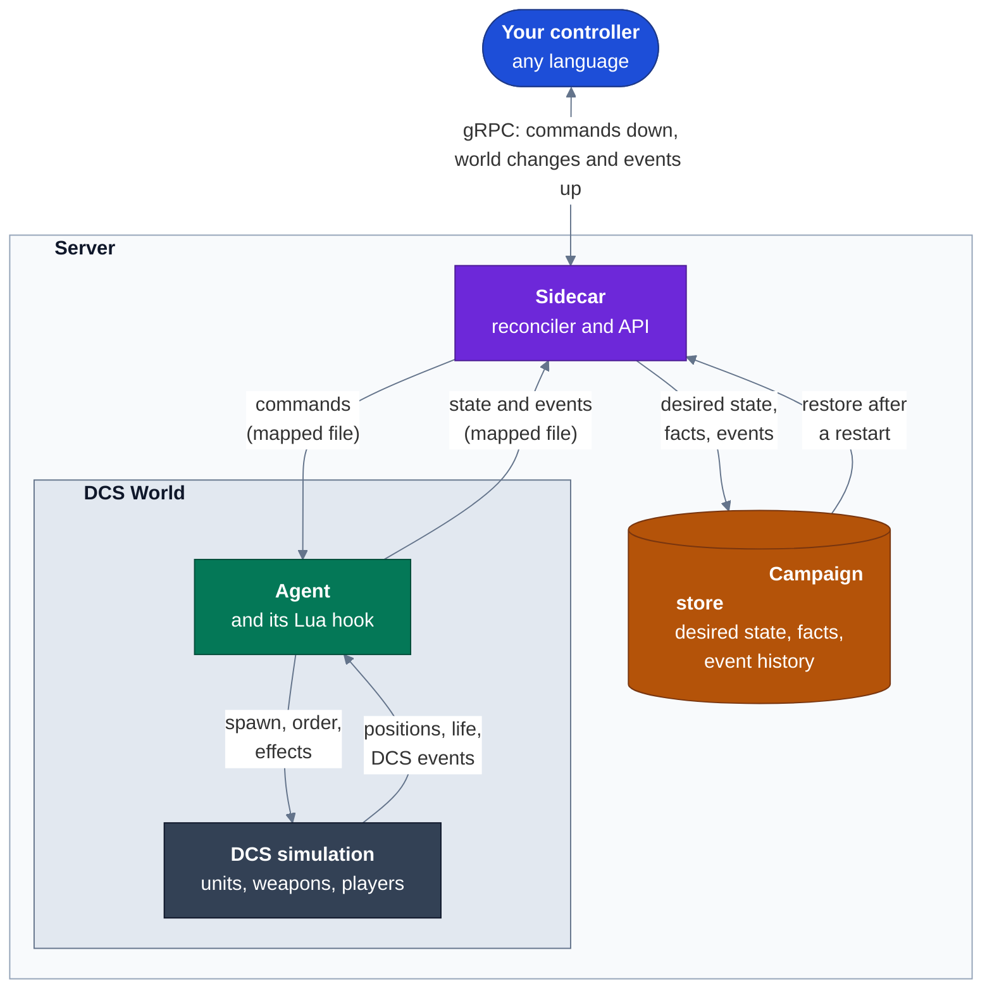

# nanoprobe

nanoprobe turns a DCS World server into a world your own program runs. You write a
program, in any language, that decides what exists on the map and what it does. DCS
does the flying, driving and fighting. The world is stored outside DCS, so it survives
mission reloads, server restarts and crashes. nanoprobe costs the server almost
nothing: its part inside DCS may use at most 0.3 % of the server's time, and it used
about 0.2 % with 2,000 objects on the map. Your program can also take units far from
any player out of DCS and keep them virtual: nanoprobe holds them, and DCS spends no
time on them. Your program brings them back, where they were, when a player comes near.
So a campaign can grow larger than DCS could hold at once.

The name comes from the Borg's nanoprobes, which take over their host from inside.

## When to use it

Use nanoprobe when you want a persistent campaign on a DCS server, run by code you
write. A program that does this is called a **controller**. It can be a dynamic
campaign, a mission generator, a training range, or a bot that answers players.

nanoprobe is not a mission framework, a mission editor or a server manager. It ships no
missions. It never starts, stops or restarts DCS.

## How it works

nanoprobe has three parts on the DCS server:

- The **agent** is a small library that DCS loads at start. It runs inside DCS, reads
  what happens there, and carries out commands. It works to a small time budget, 0.3 %
  of the server's time by default.
- The **sidecar** is a program that runs beside DCS. It stores the world and makes DCS
  match it. Your controller calls it over the network. The calls use gRPC, a common
  way for programs to call each other, available in most languages.
- **`nanoprobe`** is the command-line tool. It installs and removes the agent, checks
  a setup (`nanoprobe doctor`), and restores backups.

The sidecar and the agent talk through a mapped file: one file that both of them map
into memory. So the sidecar runs on the same machine as DCS.



Your controller tells the sidecar what it wants: "this convoy exists and drives to that
town". The sidecar stores that, then has the agent make it true in DCS. When DCS
restarts, the sidecar puts the convoy back where it was, and it drives on.

### What the messages look like

The repository has a small example controller, the hello example. It also has a fake
sidecar, which answers like the real one with no DCS behind it. The messages below come
from the hello example's steps, run against the fake sidecar. They are the API's
messages written as JSON, trimmed to the fields that matter, with times rounded.

**A command and its answer.** The controller puts a convoy of two M-113s on the
Caucasus map and orders it to drive one kilometer north. It sends `PutGroup`. The
`write` part proves the controller holds control of the server (the lease), and its
key lets a resent call take effect only once.

```json
{
  "write": {
    "lease": { "epoch": "1795722999660", "leaseId": "…" },
    "idempotency": { "key": "hello/hello-1795722999661/convoy" },
    "campaignId": "1795722999663"
  },
  "spec": {
    "label": "convoy",
    "country": 2,
    "category": "GROUP_CATEGORY_GROUND",
    "units": [
      { "type": "M-113", "label": "lead",
        "position": { "theater": "Caucasus", "north": -290000.0, "east": 680000.0 } },
      { "type": "M-113", "label": "second",
        "position": { "theater": "Caucasus", "north": -290000.0, "east": 680020.0 } }
    ]
  },
  "order": { "route": { "waypoints": [
    { "position": { "theater": "Caucasus", "north": -289000.0, "east": 680000.0 },
      "speed": 10.0 } ] } }
}
```

The sidecar stores the group and answers with its IDs. DCS spawns it a moment later.

```json
{ "groupId": "1", "unitIds": ["2", "3"], "specRevision": "1", "revision": "2" }
```

**An event.** The convoy reaches the end of its route. A program that follows the
campaign's events receives:

```json
{
  "event": {
    "sequence": "2",
    "stamp": { "modelTime": 25.7, "missionGeneration": 2 },
    "route": {
      "kind": "ROUTE_EVENT_KIND_ROUTE_COMPLETE",
      "groupId": "1",
      "orderRevision": "1",
      "observed": true
    }
  }
}
```

## What it installs, and DCS updates

DCS keeps each user's settings, missions and logs in a profile folder under Saved
Games. nanoprobe installs only there. It adds its own folder, a small loader script,
and one marked block in the profile's `Config/autoexec.cfg` that lets the agent reach
the server's scripting. Nothing is written into the DCS install, and no DCS binary is
hooked or patched.

A DCS update leaves the profile alone, so you do not reinstall nanoprobe after one. It
keeps working as long as the DCS functions it calls are still there. After an update,
`nanoprobe doctor` names any that DCS removed or renamed.

## What nanoprobe adds to DCS

- **A world that lasts.** Groups, orders, ruins and stock come back after a mission
  reload, a server restart or a crash.
- **Virtual groups.** Your controller can take a group out of DCS and bring it back.
  It returns where it was, with the damage it had.
- **Kills credited to players.** DCS reports some kills late, after the killer may
  have left. nanoprobe remembers who was in each unit, names the
  players, and dates the kill from when it happened.
- **Weapon hits credited to the shooter.** A hit or kill names the players who
  launched the weapon, even when the shooter has gone.
- **Player keys.** Every event names the players involved by a stable, private key.
  It stays the same across sessions, name changes and campaigns.
- **Route progress.** An event says when a group reaches each waypoint and the end of
  its route. nanoprobe works this out from positions.
- **Loadouts.** An event gives a player's ammunition when they take a slot and at each
  takeoff.
- **Numbered event history.** Every event has a sequence number, so a controller that
  reconnects continues where it stopped. When events are lost, a gap event says so.
- **Map drawings that stay put.** Marks and drawings have names and layers, keep their
  drawing order, and come back after a reload. Shapes known to crash DCS cannot be
  sent.
- **Warehouses and airbase owners.** They are read on a schedule. What your controller
  sets is applied again after each reload.

## What a controller can do

- Create campaigns, switch between them, and back them up.
- Place ground units, aircraft, ships and static objects, from scratch or from Mission
  Editor templates. Give aircraft a Mission Editor loadout.
- Give groups orders: follow a route, attack, hold, or orbit.
- Make far groups virtual, and bring them back, so they cost DCS no time.
- Set who owns an airbase and what its warehouse holds.
- Make explosions, smoke, flares and illumination, and clear away wrecks.
- See every unit's position and life (its health), and follow every event as it
  happens.
- Set the next mission's date, time, weather, briefing text and briefing images, and pack
  images, sounds and kneeboard pages into it.
- Reach players with messages, sounds, radio broadcasts, chat, F10 map marks and
  drawings, and radio menu items.
- Kick, ban and move players.

## Getting started

You need a DCS server, on Windows or under Wine on Linux, that you can stop and
start.

1. Download the latest release from the
   [releases page](https://github.com/tritiumgg/dcs-nanoprobe/releases).
2. Install the agent into the server's DCS profile, and write the sidecar's settings.
   [docs/install.md](docs/install.md) has each step for Windows and Linux.
3. In the Mission Editor, save one mission for each map you will use. The sidecar
   builds each campaign's mission from it.
   [docs/mission-templates.md](docs/mission-templates.md) says how.
4. Start DCS. Then start the sidecar, and check the setup:

   ```sh
   nanoprobe-sidecar run --config sidecar.toml
   nanoprobe doctor --sidecar-config sidecar.toml --theater Caucasus
   ```

5. Run the hello example in [Rust](examples/hello-rust),
   [Python](examples/hello-python) or [Kotlin](examples/hello-kotlin). It starts a
   campaign and drives two vehicles one kilometer.
   [docs/first-campaign.md](docs/first-campaign.md) walks through it. You can also run
   it with no DCS at all, against `nanoprobe-fake-sidecar` from the release folder. On a
   Mac, the macOS archive holds that program alone
   ([docs/install.md](docs/install.md), "macOS").

Each release archive also carries the documents and the
[skill for AI coding tools](skills/nanoprobe/), for the version you unpacked.

## Configuration

- **`sidecar.toml`** is the sidecar's settings file; its `--config` argument names it.
  It names the mapped file, the agent's token, the folder of mission templates, and
  where campaigns are stored. It also sets the API's address and access tokens.
- **`agent.toml`**, in the profile's `nanoprobe` folder, sets up the agent. Windows
  needs none when the sidecar runs as the same user as DCS. Under Wine it names the
  mapped file. It also sets the agent's time budget and how often it reads each value.
  Lua from a controller stays off unless this file turns it on.
- **A tokens file** gives each program that calls the API a role: observer,
  controller or admin. Without one, only programs on the server itself can connect,
  and each of them has the admin role.
- **An empty `disable` file** in the profile's `nanoprobe` folder stops the agent
  within 2 seconds of DCS's next frame, while DCS runs on. During a mission load it
  takes effect once the load ends.

[docs/configuration.md](docs/configuration.md) lists every setting, what it does, and
when to change it.

## Documentation

| For | Read |
|---|---|
| Writing a controller | [docs/controller-guide.md](docs/controller-guide.md), [docs/api-clients.md](docs/api-clients.md) |
| Running a server | [docs/operator-guide.md](docs/operator-guide.md), [docs/configuration.md](docs/configuration.md) |
| Contributing | [AGENTS.md](AGENTS.md), [docs/releasing.md](docs/releasing.md) |
| Exact behavior | [spec/](spec/) and the API schema in [proto/](proto/) |
| Test results | [docs/results/](docs/results/), [docs/acceptance.md](docs/acceptance.md) |

For AI coding tools, [skills/nanoprobe/](skills/nanoprobe/) holds a skill that points
them at these documents.

## Performance

DCS runs its simulation on one thread, and every frame nanoprobe takes there is a frame
DCS does not get. So the agent works to a budget:

- At most 0.3 % of real time on the simulation thread, by default.
- At most 250 µs of any one frame for its reads. A single DCS call cannot be split, so
  a few frames run past it.
- A separate 2 ms a frame for your controller's commands. One large command, such as a
  big spawn, can run past it in its frame.

When the budget is tight, the agent reads less often, so DCS keeps its frame rate. It
drops warehouse reads first, then life, then positions. Positions your controller
asked for go last. The server status reports how often each value was read.

Measured on a dedicated server under Wine, with 2,000 objects and one ground group in
five moving:

| Measure | Result |
|---|---|
| Mean share of real time, settled at 2,000 objects | 0.19 to 0.23 % |
| Frames over 250 µs | 0.19 to 0.27 % |
| Median time between two positions of one object | 0.993 to 1.008 s |

A frame over 250 µs is one where fixed work, a command, or one DCS call ran past the
read slice. The figures span the runs in three test reports:
[s11](docs/results/2026-11-14-s11-budget-and-baseline.md),
[s14](docs/results/2026-11-14-s14-command-path.md) and
[s19](docs/results/2026-11-17-s19-spawn-state.md).

## Limitations

- **Fuel is not tracked.**
- **Ammunition is known only for units players fly,** and only when the player takes
  the slot and at each takeoff. AI units' ammunition is never read. Flares and chaff
  cannot be read. Rearming is not seen.
- **How old values can be.** Positions are about a second old. Life is about a
  second old after a weapon hit. Damage that DCS reports no event for shows within
  about a minute. Airbase owners and stock are up to a minute old. On a busy server
  the agent reads less often, so that DCS does not slow down.
- **The API is an early version,** `v1alpha1`. A release can change it in ways that
  need client changes; its release notes say how.
- **The API has no encryption.** Off the server it needs tokens and a network you
  trust.
- **No client libraries are published.** You generate one from the release's API
  schema with your language's gRPC tools ([docs/api-clients.md](docs/api-clients.md)).
- **No missions are included.** You save the mission templates yourself.
- **Mission Editor group and static templates make ground groups and statics
  only.** Aircraft and ships are placed directly.

## License

nanoprobe is released under the [MIT License](LICENSE).
